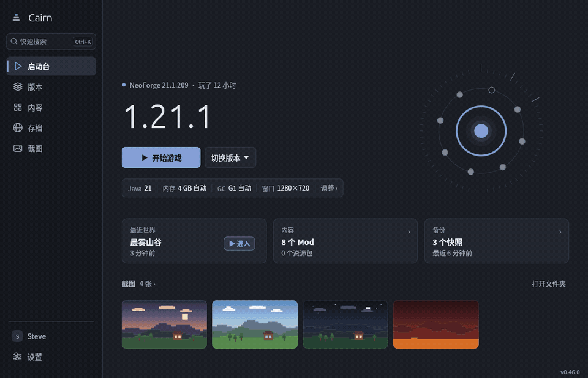
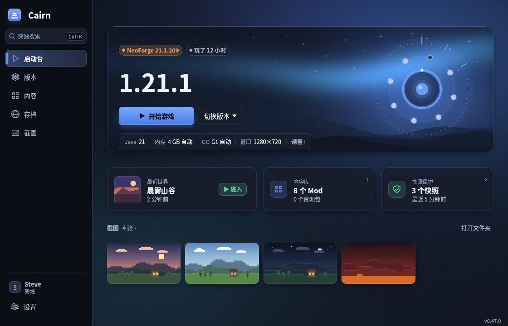
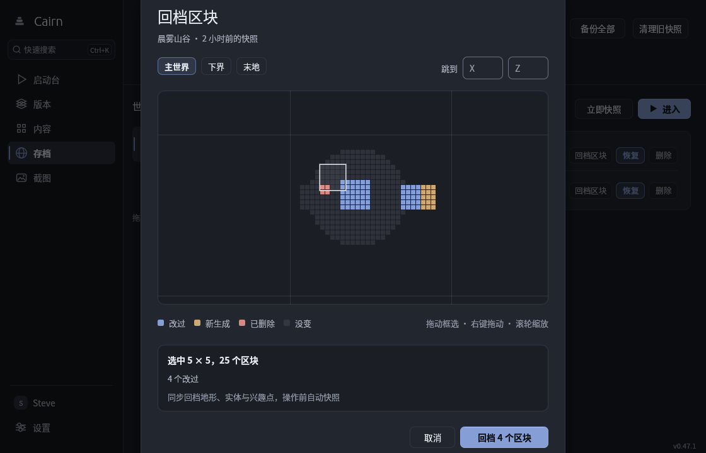
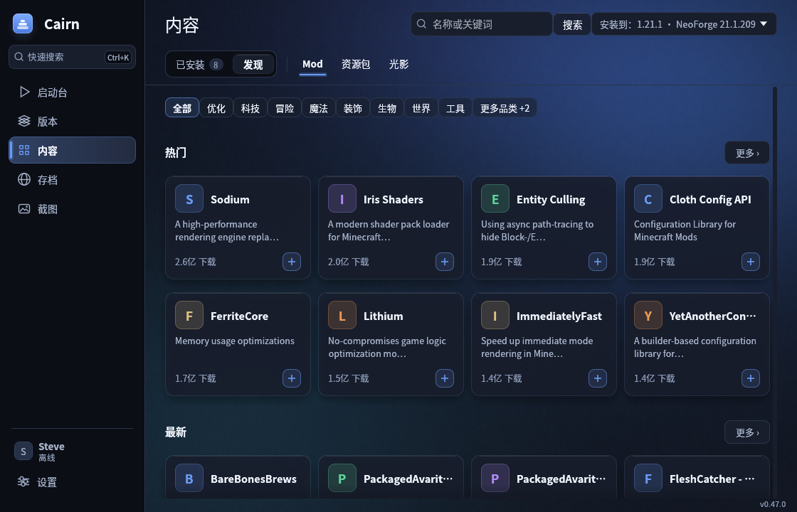
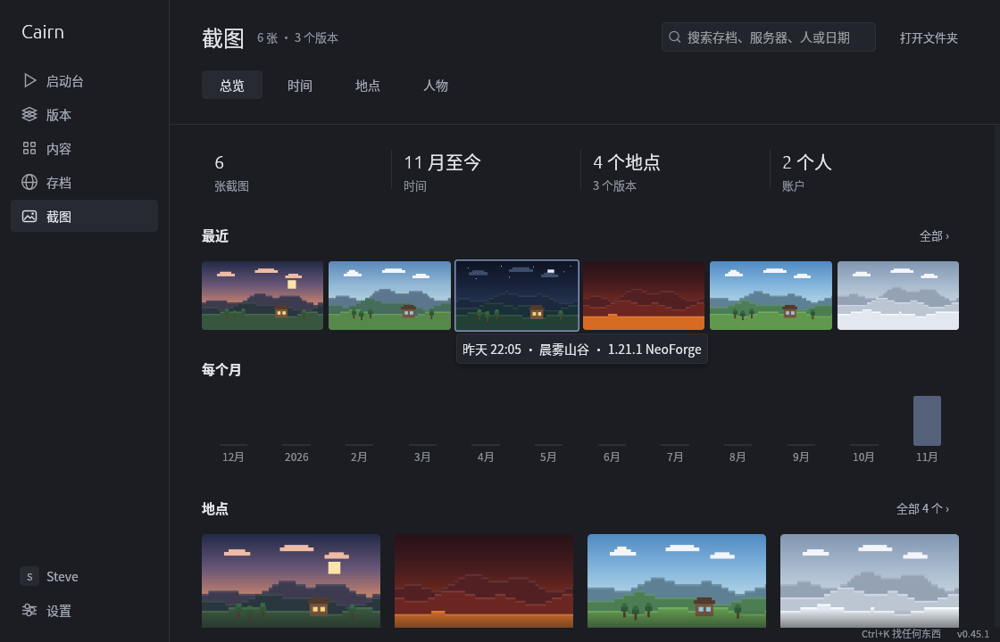
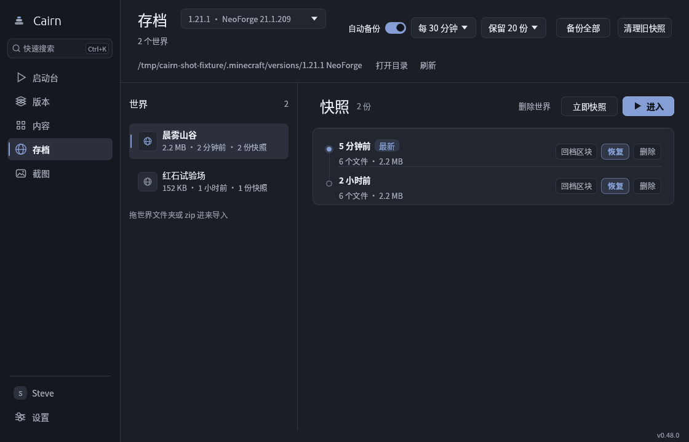
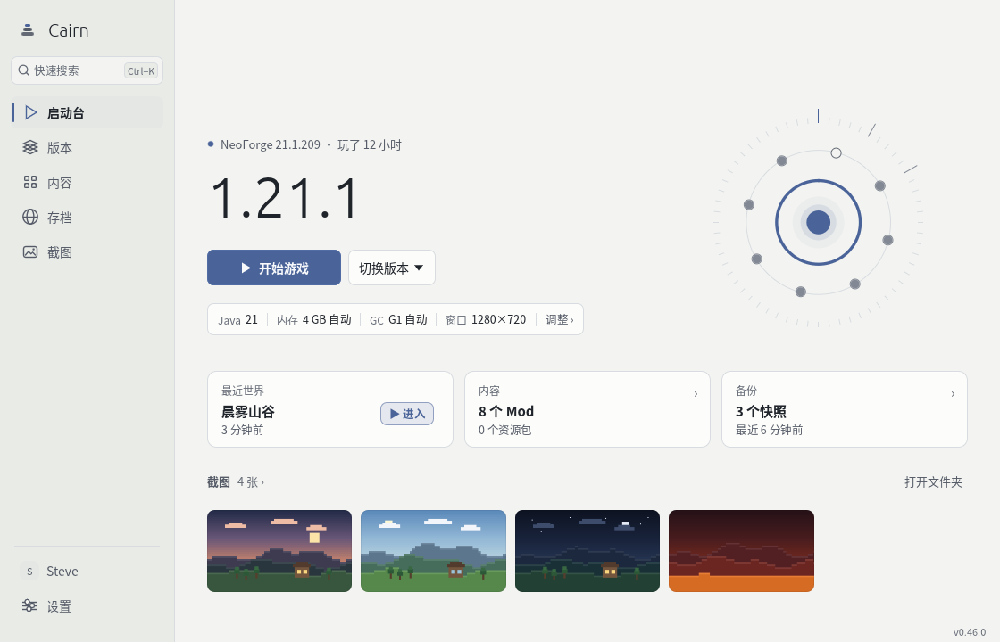

# Cairn

[](https://github.com/dkjsiogu/cairn/actions/workflows/ci.yml)
[](https://github.com/dkjsiogu/cairn/releases/latest)
[](LICENSE)

A small, native Minecraft: Java Edition launcher written in Rust (formerly nailong before 0.37). Ships as a single executable on Windows (~9 MB) and a single `.deb` on Linux (~3.7 MB), with no bundled Java runtime and 0% idle CPU.

[简体中文](README.md) | **English**

> Current version: **0.45.2** (preview) · [Changelog](CHANGELOG.md) · [Implementation status](docs/design/14-implementation-status.md)

## Why Cairn

**Clean installs, recoverable mistakes.** A cairn is the pile of stones hikers leave by a trail: it does not walk for you, it marks the way back.

- **Native & small**: written in Rust with egui; does not run on a JVM.
- **Visible, resumable installs**: staged pipeline with cancellation and repair; Forge/NeoForge client processors run directly without leaving the official installer on disk.
- **Reversible changes & chunk-level saves**: automatic restore points before mod/config/loader edits; git-style chunk-level world snapshots let you roll back only the broken chunks.
- **One folder per version**: each version lives in `versions/<name>/` with no cross-version dependencies, deletes go to the trash, and you can also point Cairn directly at an existing PCL / HMCL / official `.minecraft`.

## Interface



| Home | Chunk Rollback (0.45) |
|---|---|
|  |  |
| **Content · Discover** | **Screenshots (Time / Place / People)** |
|  |  |
| **Saves & Snapshots** | **Light Theme** |
|  |  |

All 32 screenshots (versions, install, content manager, search, details, install confirmation, restore points, accounts, tabbed settings, `Ctrl+K`, running sessions, 900×620 narrow layouts and light theme): [docs/screenshots](docs/screenshots).

## Highlights

### Install, launch & JVM tuning

- **Loaders & reuse**: vanilla, Fabric, NeoForge and Forge from official manifests; slim Forge/NeoForge installs (~3 MB core payload) plus automatic hardlink reuse of verified patched clients found in other local launchers.
- **Resilient downloads**: 4-way ranged downloads for large files; automatic fallback to [BMCLAPI](https://bmclapidoc.bangbang93.com/) (game/loaders) and [MCIM](https://github.com/mcmod-info-mirror) (Modrinth/CurseForge APIs) when official hosts fail, with API keys stripped on mirrors and official hashes always verified.
- **Automatic Java & preview**: downloads Mojang's official Java runtime (LZMA-compressed, SHA-1 verified) on demand when no compatible Java is found; per-version Java, heap, GC, resolution and flags with a copyable command-line preview.
- **Measured JVM tuning**: automatic heap sizing plus tuned G1 / generational ZGC; a built-in 7 KB synthetic Java benchmark (`cairn-cli bench`) compares G1 vs ZGC per Java 21+ runtime without opening a game window, while real session GC logs teach Auto mode how much live data your world actually uses.
- **Play-friendly**: running games never lock the launcher; multiple versions can run side by side with sidebar session tracking and a Stop button; 1.20+ Quick Play directly into a world; `Ctrl+K` command palette; `Ctrl+L` log viewer with automatic crash/missing-mod hints.

### Recoverable mistakes

- **Instance restore points**: content installs, updates, local drops, deletes and loader repairs show a confirmation checklist and take a SHA-1 deduplicated restore point first; after a crash, Cairn can roll back content changes made since the last good session in one step.
- **Chunk-level world snapshots**: Anvil region files (`region/`, `entities/`, `poi/`) are stored per chunk in pack files; unchanged worlds snapshot in milliseconds; an interactive per-dimension chunk map lets you select and restore specific chunks (terrain, entities, POI and `.mcc` together, with an automatic pre-rollback snapshot).

### Modpacks & content library

Six modpack formats are auto-detected on drag-and-drop, and any version can be exported to a minimal `.mrpack` (online files linked, custom files and selected worlds packed):

| Format | Entry point | Notes |
|---|---|---|
| Modrinth | `.mrpack` | Direct URLs + SHA-1 |
| CurseForge | zip with `manifest.json` | Official builds include a lightly XOR-obfuscated project key (shared quota, not a secret); respects disabled third-party distribution |
| Prism / MultiMC | `mmc-pack.json` (nested folder supported) | Supports component `patches/` and bundled libraries |
| MCBBS | `mcbbs.packmeta` | addons + files + overrides |
| HMCL | `modpack.json` + `minecraft/pack.json` | Embedded manifest converted to profile |
| ATLauncher | `instance.json` | Embedded manifest converted to profile |

The Content page unifies **Installed** and **Discover** for mods, resource packs and shaders (Modrinth + CurseForge real category tree), resolves `required` / `optional` / `incompatible` dependencies, supports batch drag-and-drop import, status filters, duplicate detection and confirmed updates.

### Accounts, screenshots & updates

- **Accounts**: multiple Microsoft (browser auth code + PKCE), external ([authlib-injector](https://github.com/yushijinhun/authlib-injector)) and offline accounts; passwords are never stored, and tokens are written atomically to `accounts.json` (mode `0600` on creation on Unix).
- **Screenshots**: dedicated gallery by overview, time, place and person with search; in-game screenshots embed metadata in a PNG `iTXt` chunk (lossless, optional); viewer supports zoom, copy, set world icon and trash.
- **Automatic updates**: background verified download + swap-on-exit on Windows; signed apt repository and background upgrade service on Linux.

## Download

| Platform | File | Size | Requirements |
|---|---|---:|---|
| Windows x64 | [cairn.exe](https://github.com/dkjsiogu/cairn/releases/latest/download/cairn.exe) | ~9 MB | Windows 10/11 |
| Linux x64 (deb) | [cairn_0.45.2_amd64.deb](https://github.com/dkjsiogu/cairn/releases/latest/download/cairn_0.45.2_amd64.deb) | ~3.7 MB | Ubuntu 24.04+ / glibc ≥ 2.39 |

Checksums: [SHA256SUMS](https://github.com/dkjsiogu/cairn/releases/latest/download/SHA256SUMS) (Cairn can download Mojang's Java runtime automatically if none is installed).

### Windows

Download `cairn.exe`, place it anywhere, and run it (portable `.minecraft` sits next to the exe; drop it alongside an old `nailong.exe` to keep existing data).

> The executable is not code-signed yet, so browsers or SmartScreen may warn right after a release. Verify against `SHA256SUMS`; see [22 · Windows trust](docs/design/22-windows-trust.md) (Chinese).

### Linux (Debian / Ubuntu)

Install via the signed apt repository (recommended):

```bash
sudo wget -qO /usr/share/keyrings/cairn-archive-keyring.gpg https://dkjsiogu.github.io/cairn/apt/cairn-archive-keyring.gpg
sudo wget -qO /etc/apt/sources.list.d/cairn.sources https://dkjsiogu.github.io/cairn/apt/cairn.sources
sudo apt update && sudo apt install cairn
```

Or install the `.deb` directly (adds the same apt source and replaces `nailong`):

```bash
sudo apt install ./cairn_0.45.2_amd64.deb
```

Default data lives in `~/.local/share/cairn/.minecraft` (override with `--root` or in Settings). To disable system background upgrades: `sudo rm /etc/apt/apt.conf.d/52cairn-auto-update`. Uninstall: `sudo apt remove cairn`.

> Release `.deb` packages are built on Ubuntu 24.04 / amd64 CI and require glibc ≥ 2.39 (Ubuntu 24.04+; 22.04 is not supported yet).

## Command line & build from source

Requires Rust 1.95+. Building from source produces both `cairn` (GUI) and `cairn-cli`:

```bash
# Linux build deps
sudo apt install build-essential pkg-config \
  libgl1-mesa-dev libegl1-mesa-dev \
  libx11-dev libxext-dev libxcursor-dev libxi-dev libxrandr-dev \
  libxkbcommon-dev libxkbcommon-x11-dev

cargo build --release -p nailong-ui -p nailong-cli
# Build Linux deb: ./scripts/build-deb.sh
```

```bash
cairn-cli --root /path/to/.minecraft list
cairn-cli --root /path/to/.minecraft java-install 21
cairn-cli --root /path/to/.minecraft install neoforge 1.21.1 21.1.209
cairn-cli --root /path/to/.minecraft install modpack ~/Downloads/pack.mrpack
cairn-cli --root /path/to/.minecraft export "1.21.1 NeoForge" ~/pack.mrpack
cairn-cli --root /path/to/.minecraft launch "1.21.1 NeoForge" --gc zgc --dry-run
cairn-cli bench
```

> Local builds without `NAILONG_CURSEFORGE_API_KEY` disable the CurseForge content source (Modrinth is unaffected; CurseForge packs still use the no-key fallback). Override at runtime with `CURSEFORGE_API_KEY`. Live network smoke tests: `cargo test -p nailong-core --test live_modrinth -- --ignored --nocapture`.

## Verification & not implemented yet

- **Verified**: Linux launches for 1.21.1 vanilla/Fabric/NeoForge/Forge, a 323-mod 1.7.10+LWJGL3 Prism pack, Fabulously Optimized (151 mods), and 26.x; 453 MB world chunk snapshots and rollback; BMCLAPI/MCIM fallback; LittleSkin ALI discovery; full dark/light/900×620 UI pass (0.0% idle CPU).
- **Remaining**:
  - Windows binaries are built in CI with static CRT, but **have not yet been tested on a real Windows machine**;
  - Tokens live in a `0600` file rather than the OS keychain (Credential Manager / Secret Service);
  - Skin upload/editing, full modpack updates, and macOS support.

## Project layout

```text
crates/
  nailong-core/   manifests, downloads/mirrors, Java & JVM tuning, launch, modpacks, content, rollback, chunk snapshots
  nailong-cli/    command line
  nailong-ui/     egui desktop UI
packaging/        Linux deb/apt/polkit/desktop/icons and Windows icon
scripts/          deb and apt repository build scripts
docs/
  design/         architecture and design notes (index: docs/design/00-overview.md)
  product/        product brief (docs/product/00-brief.md)
  screenshots/    dark, light and narrow screenshots
```

## Thanks

- [BMCLAPI](https://bmclapidoc.bangbang93.com/) (bangbang93) for Minecraft and mod loader mirrors.
- [MCIM](https://github.com/mcmod-info-mirror) (mcmod-info-mirror) for Modrinth and CurseForge API mirrors.
- [authlib-injector](https://github.com/yushijinhun/authlib-injector) (yushijinhun) for external login support.

## License

GPL-3.0-or-later, see [LICENSE](LICENSE). Not affiliated with Mojang Studios or Microsoft; does not bundle or redistribute Minecraft game assets.
