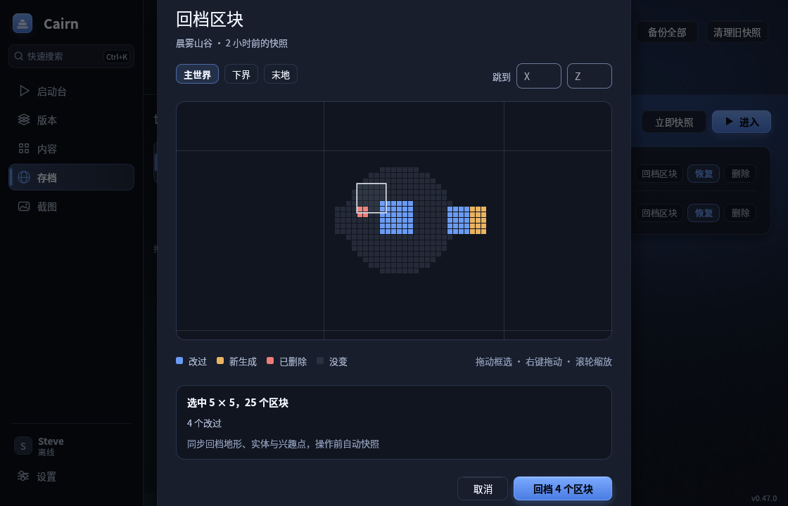
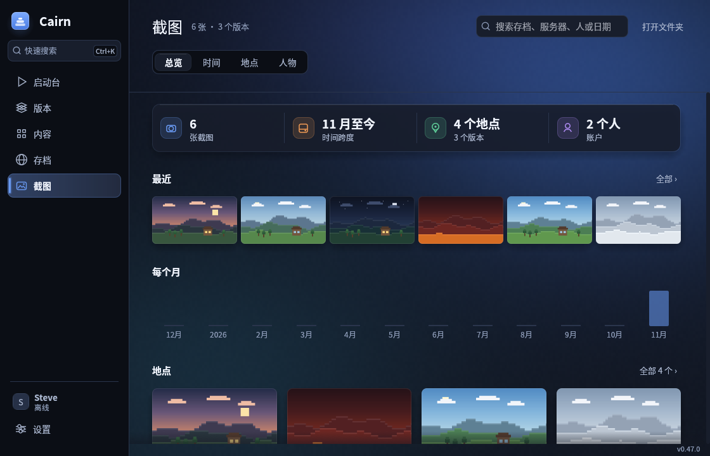
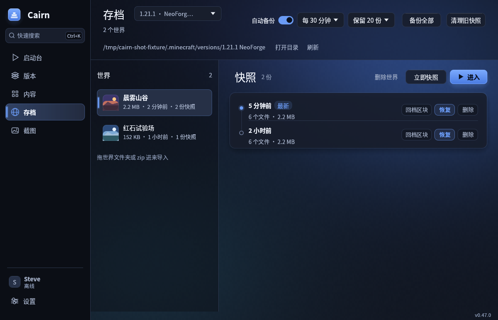

# Cairn

[](https://github.com/dkjsiogu/cairn/actions/workflows/ci.yml)
[](https://github.com/dkjsiogu/cairn/releases/latest)
[](LICENSE)

轻量、原生的 Minecraft: Java Edition 启动器，使用 Rust 编写（0.37 前原名 nailong）。Windows 只有一个 exe，Linux 只有一个 deb；不捆绑 Java 运行时，空闲 CPU 为 0%。

**简体中文** | [English](README.en.md)

> 当前版本：**0.47.0**（预览版） · [完整更新日志](CHANGELOG.md) · [实现状态与边界](docs/design/14-implementation-status.md)

## 为什么是 Cairn

**装得干净，坏了能救。** Cairn 是登山者叠在路边的石堆——它不帮你走路，只标出回去的路。

- **原生轻量**：Rust + egui 编写，不跑在 JVM 上；Windows 单文件约 9 MB，Linux deb 约 3.7 MB。
- **过程可见、中断可补**：安装拆成清晰阶段，中途取消或断网后重新开始只补缺失部分；Forge / NeoForge 直接运行客户端 processor，不留完整安装器。
- **改动可退、存档细到区块**：Mod/配置/加载器变更前自动建恢复点；世界存档走 git 式块级与区块级快照，能只回档出事的那几块区块。
- **一版本一文件夹**：每个版本独立存放在 `versions/<名字>/`，互不依赖，删掉移入回收站；也兼容直接切换使用 PCL / HMCL / 官方启动器的 `.minecraft`。

## 界面


| 启动台 | 区块级回档（0.45） |
|---|---|
|  |  |
| **内容 · 发现** | **截图（时间 / 地点 / 人物）** |
|  |  |
| **存档与快照** | **浅色主题** |
|  |  |

更多 32 张全场景截图（版本、安装、内容管理、搜索、详情、安装确认、恢复点、多账户、四栏设置、`Ctrl+K`、运行中会话、900×620 窄窗及浅色主题）：[docs/screenshots](docs/screenshots)。中文使用系统字体（Linux 上的 Noto Sans CJK，Windows 上的微软雅黑）。

## 核心特性

### 安装、启动与 JVM 调参

- **版本与加载器**：原版、Fabric、NeoForge、Forge 均从官方清单读取；原生精简安装 Forge/NeoForge（只取约 3 MB 核心数据），自动扫描并硬链接复用本机其他启动器已构建的 patched client。
- **高速下载与镜像回退**：大文件 4 段 Range 并行续传；官方连不上自动切换 [BMCLAPI](https://bmclapidoc.bangbang93.com/)（游戏/加载器）与 [MCIM](https://github.com/mcmod-info-mirror)（Modrinth/CurseForge 接口），设置可选「官方优先 / 镜像优先」，密钥不发给镜像，下载后一律按官方哈希校验。详见 [24](docs/design/24-download-sources.md)。
- **自动 Java 与参数预览**：缺合适 Java 时启动或安装加载器前自动下载 Mojang 官方运行时（优先 LZMA 压缩版、逐文件 SHA-1 校验）；启动台展示当前版本的 Java / 内存 / GC / 分辨率，可按版本覆写并复制完整命令行。
- **科学 JVM 调参**：默认「自动」内存 + 调优 G1/分代 ZGC；内置 7 KB 合成基准（`cairn-cli bench`）免开窗口对比本机各 Java 下的 G1 与 ZGC，并从每局真实 GC 日志学习常驻堆。详见 [19](docs/design/19-jvm-tuning.md)、[20](docs/design/20-tuning-benchmark.md)。
- **游玩体验**：游戏运行不锁启动器，支持多版本并行运行、侧栏状态查看与一键「结束游戏」；1.20+ 支持「进入」直达世界；`Ctrl+K` 全局命令面板；`Ctrl+L` 日志窗口自动诊断常见缺前置/崩溃原因。

### 坏了能救

- **实例恢复点**：安装、更新、拖入、删除内容或重装加载器前先弹确认清单并自动创建恢复点（SHA-1 去重）；若游戏崩溃且上次正常游玩后改过内容，底部提示「退回改动」一步还原。
- **区块级世界快照**：区域文件（`region/`、`entities/`、`poi/`）按 Minecraft 区块拆存进 pack 文件，未改动世界几毫秒完成增量快照；支持按维度查看改动热图、框选回档指定区块（地形、实体、POI 与 `.mcc` 联动，动前自动留档），也支持整份恢复和定时/退出自动备份。详见 [30](docs/design/30-chunk-snapshots.md)。

### 整合包与内容库

支持六种整合包格式自动识别，拖入 `.mrpack` 或 `.zip` 即可导入；也可将任意版本导出为最小 `.mrpack`（线上可下文件只写外链，其余打进 `overrides/`，见 [28](docs/design/28-export.md)）：

| 格式 | 入口文件 | 说明 |
|---|---|---|
| Modrinth | `.mrpack` | 直链 + SHA-1 |
| CurseForge | `manifest.json` 的 zip | 官方构建内置应用 key（XOR 混淆，仅作共享配额，可被提取）；遵守作者关闭第三方分发设置 |
| Prism / MultiMC | `mmc-pack.json`（支持套一层目录） | 支持组件补丁（`patches/`）与自带库 |
| MCBBS | `mcbbs.packmeta` | addons + files + overrides |
| HMCL | `modpack.json` + `minecraft/pack.json` | 内嵌 manifest 转实例 |
| ATLauncher | `instance.json` | 内嵌 manifest 转实例 |

内容页合并「已安装 / 发现」，锁定目标版本的 MC 版本与加载器，支持 Mod / 资源包 / 光影统一检索（Modrinth + CurseForge 真实品类树）、自动解析 `required` / `optional` / `incompatible` 前置、本地文件批量拖入、状态筛选、重复检测与带确认清单的一键更新。

### 账户、截图与自动更新

- **多账户**：支持微软正版（浏览器授权码 + PKCE）、外置登录（[authlib-injector](https://github.com/yushijinhun/authlib-injector)，如 LittleSkin）和离线账户，不保存密码，凭证以 Unix `0600` 原子写入 `accounts.json`。
- **截图管理**：独立「截图」页支持总览、时间、地点、人物四个视图和搜索；游戏内截图自动写入 PNG `iTXt` 信息块（不改像素，可关闭），看图支持缩放、复制、设为世界图标与移入回收站。
- **自动更新**：Windows 后台下载并按 `SHA256SUMS` 校验、关闭时替换；Linux deb 自动配置签名 apt 源，打开时静默升级或通过系统授权立即更新（见 [26](docs/design/26-auto-update.md)）。

## 下载

| 平台 | 文件 | 大小 | 要求 |
|---|---|---:|---|
| Windows x64 | [cairn.exe](https://github.com/dkjsiogu/cairn/releases/latest/download/cairn.exe) | 约 9 MB | Windows 10/11 |
| Linux x64 (deb) | [cairn_0.47.0_amd64.deb](https://github.com/dkjsiogu/cairn/releases/latest/download/cairn_0.47.0_amd64.deb) | 约 3.7 MB | Ubuntu 24.04+ / glibc ≥ 2.39 |

校验值：[SHA256SUMS](https://github.com/dkjsiogu/cairn/releases/latest/download/SHA256SUMS)（缺少 Java 时启动器可自动下载官方运行时）。

### Windows

下载 `cairn.exe` 放到任意目录双击运行（便携数据默认存在同目录 `.minecraft`；从 `nailong.exe` 升级直接放同目录即可）。

> exe 暂未代码签名，新版本刚发布时浏览器可能提示「通常不会下载」、Windows 可能提示「未知发布者」，可用 `SHA256SUMS` 核对文件。原因和计划见 [22 · Windows 下载提示](docs/design/22-windows-trust.md)。

### Linux（Debian / Ubuntu）

通过 apt 源安装（推荐，随系统更新）：

```bash
sudo wget -qO /usr/share/keyrings/cairn-archive-keyring.gpg https://dkjsiogu.github.io/cairn/apt/cairn-archive-keyring.gpg
sudo wget -qO /etc/apt/sources.list.d/cairn.sources https://dkjsiogu.github.io/cairn/apt/cairn.sources
sudo apt update && sudo apt install cairn
```

或直接安装 `.deb`（会自动添加上述 apt 源，并替换旧的 `nailong` 包）：

```bash
sudo apt install ./cairn_0.47.0_amd64.deb
```

数据默认位于 `~/.local/share/cairn/.minecraft`（启动器也可用 `--root <目录>` 指定目录，或在设置中切换至已有 `.minecraft`）。如需彻底关闭系统后台更新：`sudo rm /etc/apt/apt.conf.d/52cairn-auto-update`；卸载：`sudo apt remove cairn`。

> 官方 deb 在 Ubuntu 24.04 / amd64 CI 上构建，要求 glibc ≥ 2.39（Ubuntu 24.04+ 可直接安装，22.04 暂不支持）。

## 命令行与源码构建

deb 只含 GUI；从源码构建（需要 Rust 1.95+）会同时生成 GUI `cairn` 和 CLI `cairn-cli`：

```bash
# Linux 依赖
sudo apt install build-essential pkg-config \
  libgl1-mesa-dev libegl1-mesa-dev \
  libx11-dev libxext-dev libxcursor-dev libxi-dev libxrandr-dev \
  libxkbcommon-dev libxkbcommon-x11-dev

cargo build --release -p nailong-ui -p nailong-cli
# 构建 Linux deb：./scripts/build-deb.sh（产物在 dist/）
```

常用 CLI 示例：

```bash
cairn-cli --root /path/to/.minecraft list
cairn-cli --root /path/to/.minecraft java-install 21
cairn-cli --root /path/to/.minecraft install neoforge 1.21.1 21.1.209
cairn-cli --root /path/to/.minecraft install modpack ~/Downloads/pack.mrpack
cairn-cli --root /path/to/.minecraft export "1.21.1 NeoForge" ~/pack.mrpack
cairn-cli --root /path/to/.minecraft launch "1.21.1 NeoForge" --gc zgc --dry-run
cairn-cli bench
```

> 本地构建未设置 `NAILONG_CURSEFORGE_API_KEY` 时会禁用 CurseForge 源（Modrinth 不受影响，整合包仍走无 key 回退）；运行时可用 `CURSEFORGE_API_KEY` 覆盖。联网冒烟测试：`cargo test -p nailong-core --test live_modrinth -- --ignored --nocapture`。

## 验证范围与还没做

- **已实际验证**：Linux 下 1.21.1 原版/Fabric/NeoForge/Forge、1.7.10+LWJGL3 大型 Prism 包（323 Mod）、Fabulously Optimized（151 Mod）及 26.x 实装与进游戏；453 MB 世界区块快照与回档；BMCLAPI / MCIM 镜像降级；LittleSkin 外置登录探测；全页深浅色与 900×620 窄窗走查（空闲 CPU 0.0%）。
- **尚未完成 / 待验证**：
  - Windows 由 CI 原生静态 CRT 构建，但**尚未在 Windows 实机完整验证**；
  - 账户令牌目前为 Unix `0600` 文件存储，尚未接入系统钥匙串（Windows Credential Manager / Linux Secret Service）；
  - 皮肤上传/更换、整合包增量更新、macOS 支持。

## 代码结构与文档

```text
crates/
  nailong-core/   版本解析、下载/镜像、Java 与 JVM 调参、启动、整合包、内容库、恢复点、区块快照
  nailong-cli/    命令行
  nailong-ui/     egui 图形界面
packaging/        Linux deb/apt/polkit/desktop/图标 与 Windows 图标
scripts/          deb 与 apt 仓库构建脚本
docs/
  design/         30 篇架构与设计文档（索引见 docs/design/00-overview.md）
  product/        产品 brief（docs/product/00-brief.md）
  screenshots/    全套深浅色与窄窗截图
```

## 致谢

- [BMCLAPI](https://bmclapidoc.bangbang93.com/)（bangbang93）提供 Minecraft 和加载器的下载镜像。
- [MCIM](https://github.com/mcmod-info-mirror)（mcmod-info-mirror）提供 Modrinth 和 CurseForge 的接口镜像。
- [authlib-injector](https://github.com/yushijinhun/authlib-injector)（yushijinhun）让外置登录成为可能。

Cairn 按社区镜像约定使用：官方优先、标明来源、不做二次封装（见 [24](docs/design/24-download-sources.md)）。

## 许可

GPL-3.0-or-later，见 [LICENSE](LICENSE)。本项目与 Mojang Studios、Microsoft 无隶属关系，不附带、不分发任何 Minecraft 游戏资源。
